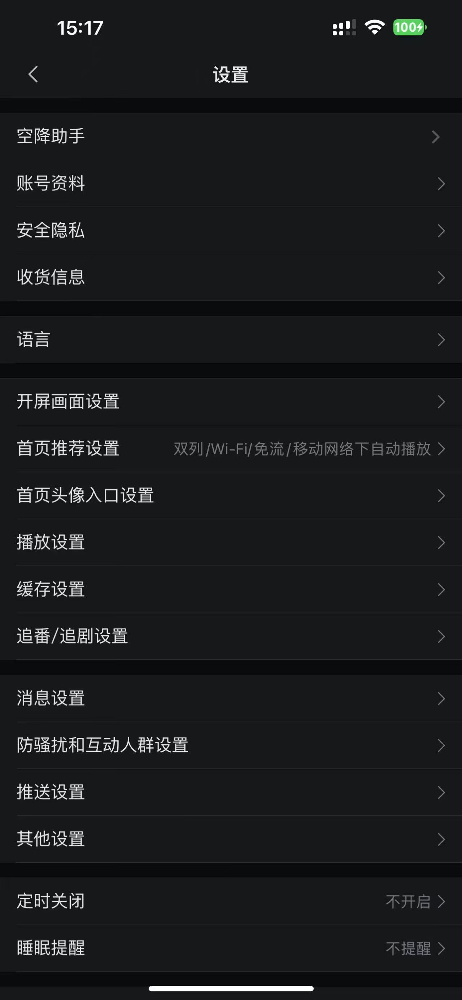
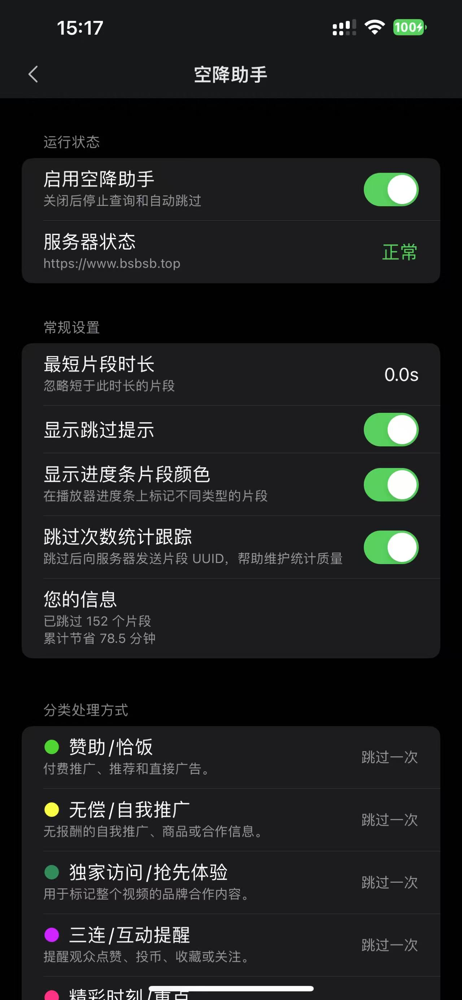
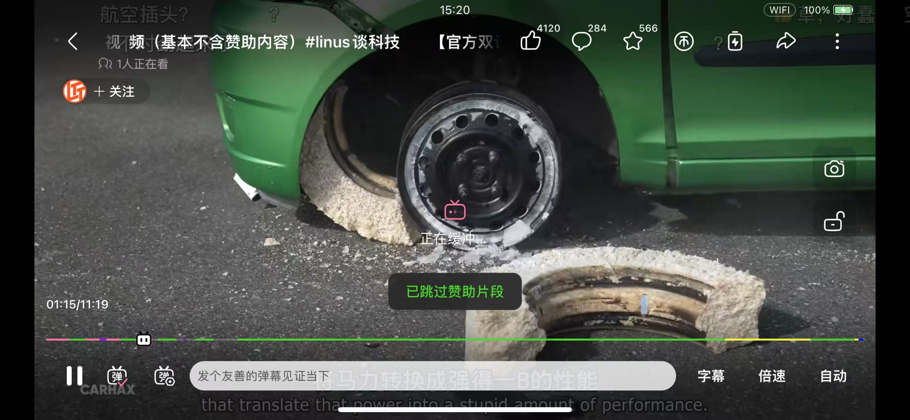

# BiliSponsorBlock-ios

适用于官方哔哩哔哩 iOS App 的空降助手插件，通过注入 dylib 的方式提供 SponsorBlock 片段识别、提示和自动跳过功能。
本插件借助 [BilibiliSponsorBlock](https://github.com/hanydd/BilibiliSponsorBlock) 项目的支持，实现空降片段数据获取与相关功能。

## 功能

### 已实现功能
- 自动识别当前视频的 BV 号并解析 SponsorBlock 空降片段
- 自动跳过赞助、自我推广、互动提醒、片头片尾、离题等分类片段
- 为不同片段分类设置独立处理方式
- 支持“总是跳过”“跳过一次”“手动跳过”“仅显示”和“禁用”
- 显示片段分类和跳过提示
- 在播放器进度条上以分类颜色标记片段位置
- 在哔哩哔哩设置页面中提供独立的“空降助手”设置入口
- 记录跳过次数和累计节省时间
- 支持总开关和插件功能配置
  
### 待实现功能
- 向 BilibiliSponsorBlock 提交赞助时间片段
- 竖屏模式下彩色进度条
- ........

## 功能预览

<table>
  <tr>
    <td width="50%"></td>
    <td width="50%"></td>
  </tr>
  <tr>
    <td width="50%"></td>
    <td width="50%"></td>
  </tr>
</table>

## 适配及安装

- iOS 15.0 及以上
- ARM64
- 官方哔哩哔哩 iOS App 9.0.0及以上
- 可用于支持 dylib 注入的安装方式

